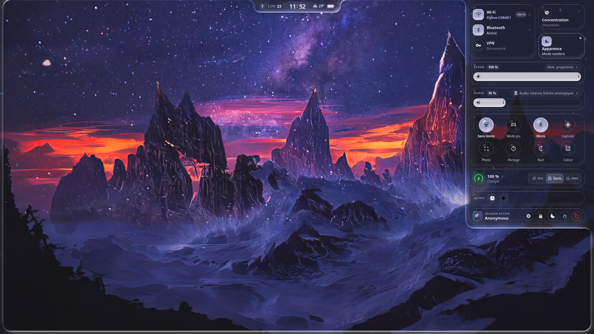
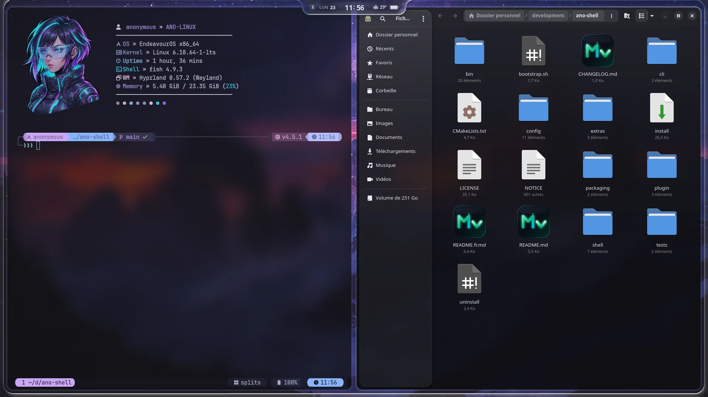
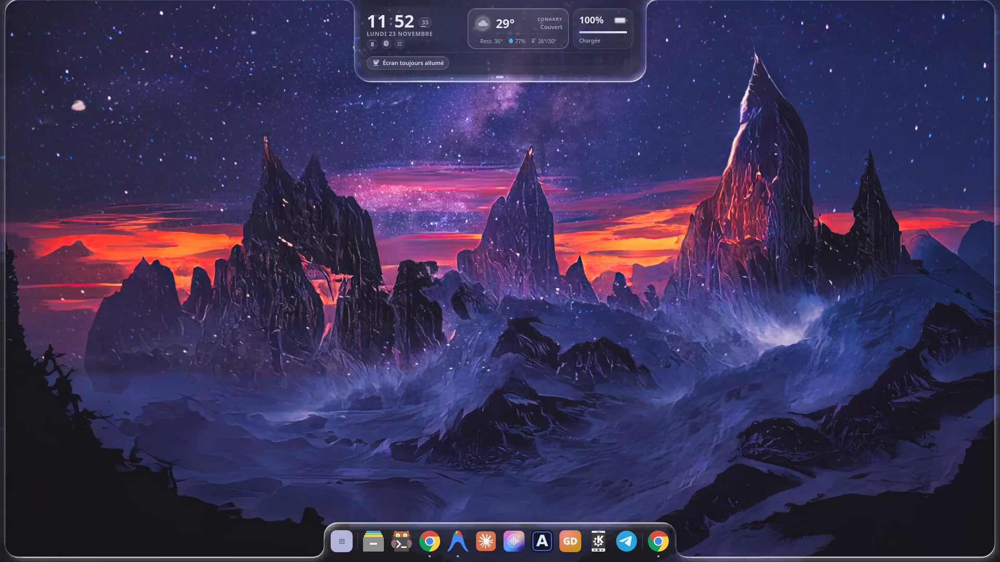
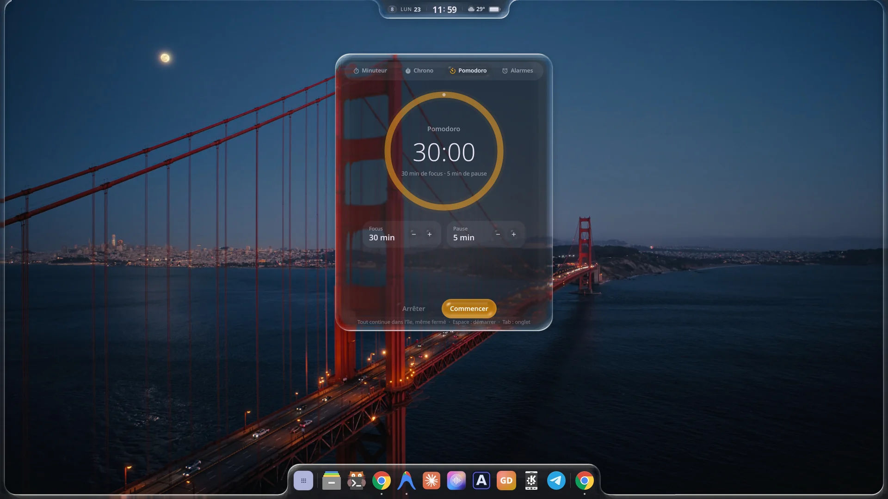
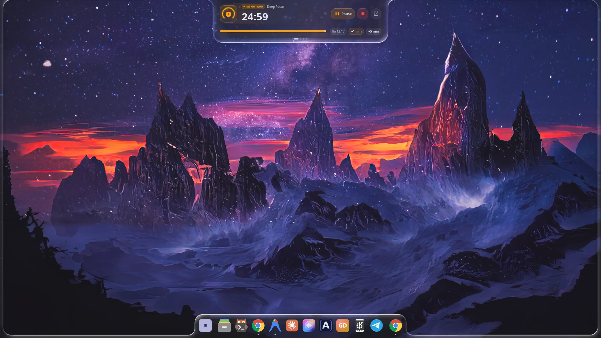
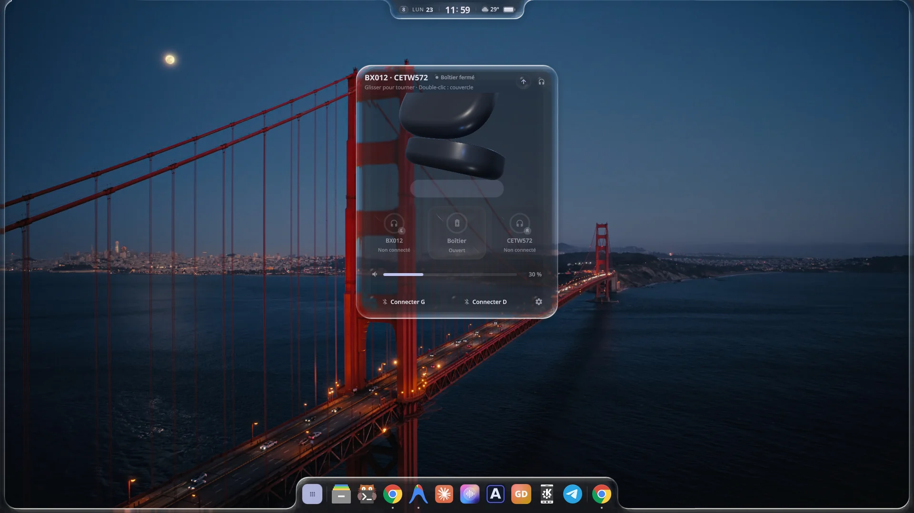
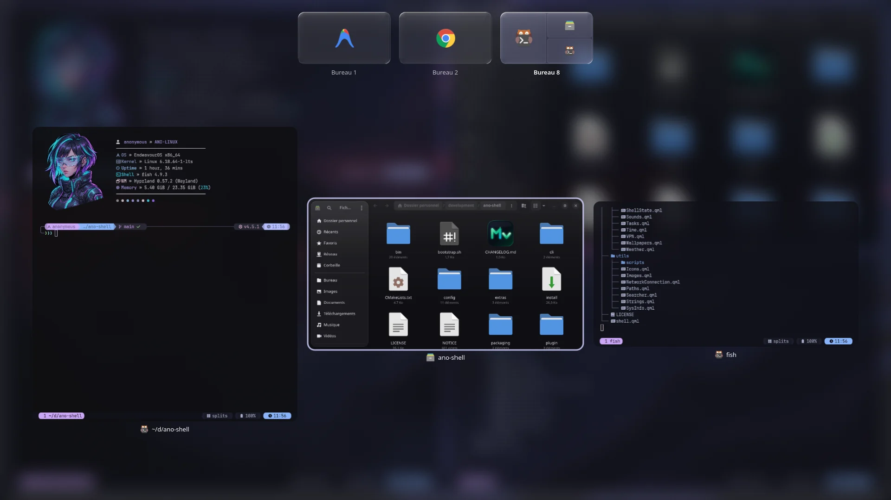
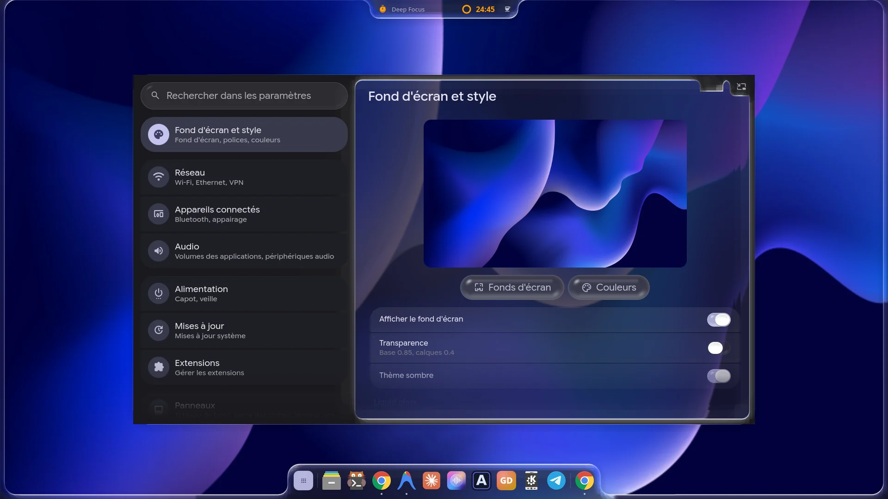
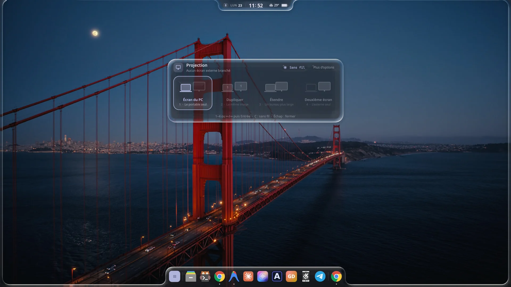

<div align="center">

# 🫧 Ano Shell

**Bureau Liquid Glass 100 % autonome pour Arch Linux & Hyprland.**

Shaders GLSL Qt6 réfractifs sur mesure, Dynamic Island iOS 27, Centre de contrôle façon macOS 27, Dock masquable, Écouteurs 3D en verre, Mission Control, Spotlight, Kitty & Nautilus Liquid Glass — s'installe en **une seule commande** depuis un Arch Linux vierge (**« no desktop »**), **sans aucune dépendance** à `caelestia-shell`, `caelestia-cli`, `libcava`, `sndio` ni `aubio`.

[](https://archlinux.org)
[](https://hyprland.org)
[](plugin/)
[](plugin/)
[](LICENSE)
[](https://github.com/Abdoul273/ano-shell/actions/workflows/ci.yml)

[🇬🇧 English](README.md) · **🇫🇷 Français**

[Galerie](#-galerie) · [Points forts](#-pourquoi-ano-shell-) · [Installation 1 commande](#-guide-complet-pour-débutant-depuis-zéro-sur-arch-linux) · [Profils de performance](#-profils-de-performance) · [Raccourcis](#-raccourcis-essentiels-tous-préconfigurés) · [CLI](#-commandes-cli-ano-shell)

<br>



<sub><b>Ano Shell · Bureau Liquid Glass</b> — Verre réfractif GLSL Qt6 sur mesure, Dynamic Island équilibrée et Centre de contrôle macOS 27 en direct sur Hyprland.</sub>

</div>

---

## ✨ Galerie

<table>
  <tr>
    <td width="50%">
      
      <br /><sub><b>Terminal &amp; Applis GTK4 en verre</b> — Tiling Hyprland avec Kitty Liquid Glass (onglets pilules, Fastfetch, Starship) &amp; Nautilus translucide</sub>
    </td>
    <td width="50%">
      
      <br /><sub><b>Dynamic Island · Vue Infos en direct</b> — Horloge roulante, météo en direct, batterie, pastilles d'état &amp; Dock Liquid Glass</sub>
    </td>
  </tr>
  <tr>
    <td width="50%">
      
      <br /><sub><b>Gouttes de verre réfractives</b> — Horloge, Minuteur, Chrono &amp; Pomodoro qui sortent de l'île avec réfraction optique en temps réel</sub>
    </td>
    <td width="50%">
      
      <br /><sub><b>Dynamic Island · Minuteur &amp; Focus</b> — Compte à rebours lumineux, actions rapides +1/+5 min et transitions fluides en verre</sub>
    </td>
  </tr>
  <tr>
    <td width="50%">
      
      <br /><sub><b>Écouteurs 3D en verre</b> — Popup façon AirPodsDesktop avec boîtier 3D articulé temps réel, connexions Bluetooth G/D &amp; volume</sub>
    </td>
    <td width="50%">
      
      <br /><sub><b>Mission Control</b> — Grille des fenêtres en direct &amp; aperçu des bureaux via <code>Super + Tab</code> ou geste 3 doigts ↑</sub>
    </td>
  </tr>
  <tr>
    <td width="50%">
      
      <br /><sub><b>Paramètres &amp; Material You en direct</b> — Palettes dynamiques, densité du verre, mode clair/sombre &amp; profils de performance</sub>
    </td>
    <td width="50%">
      
      <br /><sub><b>Projection d'écran &amp; Dock</b> — Bascule instantanée PC seul / Dupliquer / Étendre / Sans fil (<code>Super + P</code>) &amp; Dock macOS</sub>
    </td>
  </tr>
</table>

---

## ⚡ Pourquoi Ano Shell ?

- **100 % autonome en C++ natif** : plugins Qt6 C++ (`AnoShell.*` + `AnoShell.Shapes`) avec spectre audio PipeWire + `fftw3` natif et service `SystemWatch` C++ (`/sys` sans `fork/exec`). Aucune dépendance à `caelestia-shell`, `caelestia-cli`, `libcava`, `sndio` ou `aubio`.
- **Écosystème Liquid Glass complet** : Dynamic Island iOS 27 (infos, performances/processus, média + paroles synchronisées, notifications, agents IA, horloge, transferts), Centre de contrôle, Dock masquable, 14 popups gouttes de verre, Mission Control, Écran de verrouillage, **SDDM Liquid Glass**, **Nautilus + Sushi** (GTK4/3 + portail Ouvrir/Enregistrer), **Qt/KDE Darkly**, **Kitty** (barre pilules + terminal déroulant `Super + \``), **Fastfetch**, **Fish + Starship** (`eza`, `zoxide`) et lecteur musique **`onde-cli`**.
- **Fluide sur portable 2 cœurs comme sur gros GPU** : détection matérielle à l'installation avec **3 profils de performance** (`ultra` / `eco` / `auto`), shader rapide (`liquidios-fast.frag`), masque fenêtre événementiel, panneaux chargés à la demande (`LazyPanel`) et services à la demande.
- **Interface bilingue FR / EN** : suit automatiquement la langue du système et bascule en direct dans **Paramètres (`Super + I`) → Langue et région**.

---

## 🎛️ Profils de performance

Choisis ton profil de façon interactive pendant `./install`, en ligne de commande ou en direct dans **Paramètres (`Super + I`) → Fond d'écran et style** :

| Profil | Idéal pour | Comportement |
| :--- | :--- | :--- |
| **`ultra`** | GPU dédié / PC fixe / Portable puissant | Shader réfractif complet (`liquidios.frag`), panneaux préchargés, rendu maximal |
| **`eco`** *(Fluide)* | Portable Intel 2 cœurs / iGPU / Autonomie | Shader optimisé (`liquidios-fast.frag`, ~2× moins de lectures texture, rendu identique), panneaux chargés à la demande (déchargés après 90 s), faible CPU/RAM |
| **`auto`** | PC portables hybrides | Bascule automatiquement entre `ultra` sur secteur et `eco` sur batterie |

```bash
./install --profile auto        # ou ultra | eco
ano-shell glass --performance auto
```

---

## 🚀 Guide complet pour débutant (depuis zéro sur Arch Linux)

Tu viens d'installer Arch Linux (ou tu veux l'installer) et tu n'as jamais configuré Hyprland ? Suis simplement ces **4 étapes** :

### Étape 1 — Installer Arch Linux minimal (`archinstall`)
1. Démarre sur la clé USB Arch Linux et lance `archinstall`.
2. Choisis :
   - **Profile** → **`Minimal`** (ou **`No desktop`**)
   - **Audio** → **`PipeWire`**
   - **Network configuration** → **`Use NetworkManager`**
   - **User account** → crée ton compte utilisateur avec **`Superuser (sudo) = Yes`**
3. Lance l'installation puis redémarre et retire la clé USB.

### Étape 2 — Te connecter sur l'écran noir (TTY)
1. Tape ton **nom d'utilisateur** puis ton **mot de passe** (rien ne s'affiche quand tu tapes le mot de passe, c'est normal).
2. Si tu es en **Wi-Fi**, connecte-toi facilement avec :
   ```bash
   nmtui
   ```
   *(Choisis « Activate a connection », sélectionne ton Wi-Fi, tape le mot de passe, puis Quitter.)*
   *(En câble Ethernet, internet fonctionne déjà tout seul.)*

### Étape 3 — Lancer l'installation automatique en 1 commande
Tape cette unique commande puis appuie sur **Entrée** :

```bash
curl -fsSL https://raw.githubusercontent.com/Abdoul273/ano-shell/main/bootstrap.sh | bash
```

Entre ton mot de passe `sudo` quand demandé, puis laisse faire (~5 à 15 min selon ton PC et ta connexion).

**Tout est installé et configuré tout seul :**
- Hyprland, Wayland, audio PipeWire, Bluetooth, Wi-Fi, gestion d'énergie et **écran de connexion SDDM Liquid Glass** + curseur macOS.
- Plugins C++ Qt6 natifs (`AnoShell.*` + `AnoShell.Shapes`) compilés automatiquement (spectre audio FFT natif `fftw3` + PipeWire, sans `libcava`/`sndio`).
- **Tout le Liquid Glass iOS 27 / macOS** : Dynamic Island, Centre de contrôle, Dock, 14 popups gouttes de verre, Mission Control, Écran de verrouillage, **Nautilus + Sushi**, **Qt/KDE Darkly**, **Kitty**, **Fastfetch**, **Fish + Starship**, **Firefox** et **`onde-cli`**.
- **Réglage matériel automatique** : détecte ton GPU, tes cœurs CPU et ta batterie pour recommander le profil Liquid Glass optimal.

### Étape 4 — Redémarrer et profiter
Une fois terminé, tape simplement :

```bash
sudo reboot
```

Tu arrives directement sur ton **écran de connexion Liquid Glass**, puis sur ton bureau Hyprland + Ano Shell prêt à l'emploi.

---

## 🔧 Installation sur un Hyprland déjà configuré

Si tu as déjà un Arch + Hyprland configuré, l'installeur **ne casse rien** (sauvegarde horodatée + 1 seule ligne `source` ajoutée) :

```fish
git clone https://github.com/Abdoul273/ano-shell.git
cd ano-shell
./install                          # mode greffe sur ton hyprland.conf existant
# choisir directement un profil de performance :
./install --profile ultra          # ultra | eco | auto
# ou migrer depuis Caelestia Liquid Glass sans rien modifier là-bas :
./install --migrate-caelestia
```

Désinstallation réversible à tout moment : `./uninstall`.

---

## ⌨️ Raccourcis essentiels (tous préconfigurés)

Appuie sur **`Super + H`** à tout moment pour ouvrir l'aide interactive des raccourcis.

| Raccourci | Action |
| :--- | :--- |
| **`Super + Espace`** | Recherche Spotlight (goutte de verre) |
| **`Super + A`** | Centre de contrôle Liquid Glass (ou coin haut-droit) |
| **`Super + N`** | Centre de notifications dans l'île |
| **`Super + I`** | Paramètres (Liquid Glass, profils de performance, thèmes, langue FR/EN) |
| **`Super + T`** ou **`Super + Entrée`** | Terminal Kitty Liquid Glass |
| **`Super + \``** | Terminal Kitty déroulant depuis le haut |
| **`Super + E`** | Fichiers Nautilus (Liquid Glass + aperçu rapide `Espace`) |
| **`Super + W`** | Navigateur web |
| **`Super + M`** | Lecteur musique **`onde-cli`** (paroles synchronisées dans l'île) |
| **`Super + V`** / **`Super + .`** / **`Super + O`** | Presse-papiers / Emojis / Calculatrice (gouttes de verre) |
| **`Super + P`** | Projection d'écran (PC seul, Dupliquer, Étendre, Sans fil) |
| **`Super + Maj + N`** / **`Super + Maj + T`** | Notes rapides / Tâches rapides |
| **`Super + Maj + O`** | Horloge (minuteur, chrono, pomodoro, alarmes) |
| **`Super + Maj + B`** | Écouteurs 3D façon AirPods |
| **`Super + Maj + Espace`** | Assistant vocal (`ano-siri`, chargé à la demande) |
| **`Super + Maj + D`** / **`W`** / **`Super + Alt + T`** | Dictée vocale / Outils d'écriture / Traduction |
| **`Super + Tab`** (ou 3 doigts ↑) | Mission Control |
| **`Impr. écran`** / **`Super + Impr. écran`** | Capture plein écran / Capture zone + annotation |
| **`Super + L`** / **`Ctrl + Alt + Suppr`** | Verrouiller l'écran / Menu de session |
| **`Super + Q`** / **`Super + Maj + Q`** | Fermer la fenêtre / Quitter complètement l'appli |
| **`Super + Maj + R`** | Recharger Hyprland + Ano Shell |

---

## 💻 Commandes CLI (`ano-shell`)

| Commande | Rôle |
| :--- | :--- |
| `ano-shell shell -d` / `-k` | Démarre ou arrête le shell (bloque l'arrêt si l'écran est verrouillé) |
| `ano-shell wallpaper -f ` | Change le fond d'écran et génère la palette dynamique Material You |
| `ano-shell scheme set -m dark\|light` | Change le thème ou bascule clair/sombre |
| `ano-shell glass --auto` | Détecte GPU/batterie et applique le profil Liquid Glass optimal |
| `ano-shell glass --performance ultra\|eco\|auto` | Bascule en direct le shader Liquid Glass et le chargement paresseux |
| `ano-shell theme` | Régénère GTK4/3 Liquid Glass, portail GTK3, Qt/Darkly et Hyprland |
| `ano-shell screenshot` / `record` | Capture d'écran et enregistrement vidéo `gpu-screen-recorder` |
| `ano-shell doctor` | Vérifie l'ABI Qt6 de Quickshell, `ldd` des plugins, JSON et Hyprland |
| `ano-shell migrate` | Copie les réglages depuis `~/.config/caelestia` sans y toucher |
| `onde-cli` | Lance le lecteur musique terminal synchronisé avec la Dynamic Island |

---

## 📄 Licence & Attribution

Licence **GPL-3.0**. Dérivé de [caelestia-dots/shell](https://github.com/caelestia-dots/shell) (GPL-3.0) et [m3shapes](https://github.com/soramanew/m3shapes) (Apache-2.0) ; voir [NOTICE](NOTICE).
