<div align="center">

# 🫧 Ano Shell

**Standalone Liquid Glass desktop environment for Arch Linux & Hyprland.**

Custom Qt6 GLSL refractive shaders, Dynamic Island iOS 27, macOS-style Control Center, auto-hiding Dock, 3D Earbuds HUD, Mission Control, Spotlight, Glass Kitty & Nautilus — installs from a fresh `no desktop` TTY in **one command**, with **zero dependency** on `caelestia-shell`, `caelestia-cli`, `libcava`, `sndio` or `aubio`.

[](https://archlinux.org)
[](https://hyprland.org)
[](plugin/)
[](plugin/)
[](LICENSE)
[](https://github.com/Abdoul273/ano-shell/actions/workflows/ci.yml)

**🇬🇧 English** · [🇫🇷 Français (guide pas-à-pas)](README.fr.md)

[Showcase](#-showcase) · [Highlights](#-why-ano-shell) · [1-Command Install](#-step-by-step-beginner-guide-from-a-fresh-arch-linux-install) · [Performance Profiles](#-performance-profiles) · [Shortcuts](#-essential-shortcuts-pre-configured) · [CLI](#-cli-overview-ano-shell)

<br>

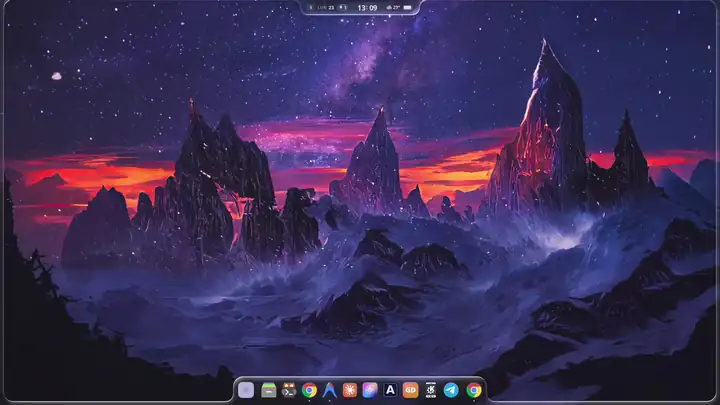

<sub><b>Ano Shell · Live Liquid Glass Demo</b> — Dynamic Island, macOS 27 Control Center, optical refraction Clock &amp; Glass Kitty/Nautilus (<a href="https://github.com/Abdoul273/ano-shell/releases/download/v1.0.0/ano-shell-demo.mp4">Watch full 1080p 60 FPS video</a>).</sub>

</div>

---

## ✨ Showcase

<table>
  <tr>
    <td colspan="2" align="center">
      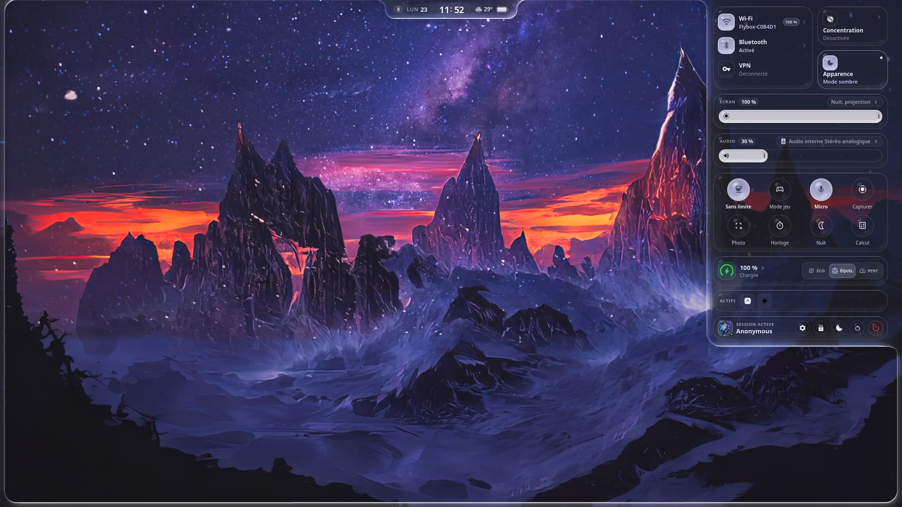
      <br /><sub><b>Control Center &amp; Dynamic Island</b> — Custom refractive Qt6 GLSL glass, balanced Dynamic Island, and macOS 27 Control Center</sub>
    </td>
  </tr>
  <tr>
    <td width="50%">
      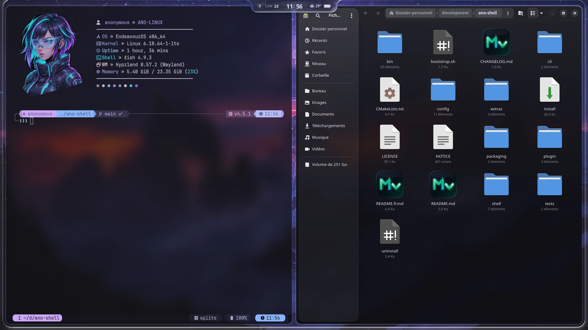
      <br /><sub><b>Glass Terminal &amp; GTK4 Apps</b> — Hyprland tiling with Kitty Liquid Glass (pill tab bar, Fastfetch, Starship) &amp; translucent Nautilus</sub>
    </td>
    <td width="50%">
      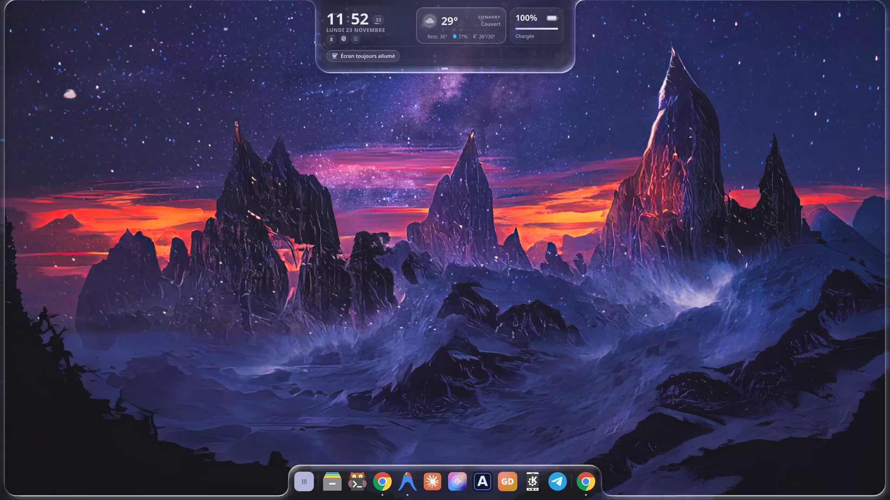
      <br /><sub><b>Dynamic Island · Live Info HUD</b> — Rolling clock, live weather, battery telemetry, system pills &amp; auto-hiding Liquid Glass Dock</sub>
    </td>
  </tr>
  <tr>
    <td width="50%">
      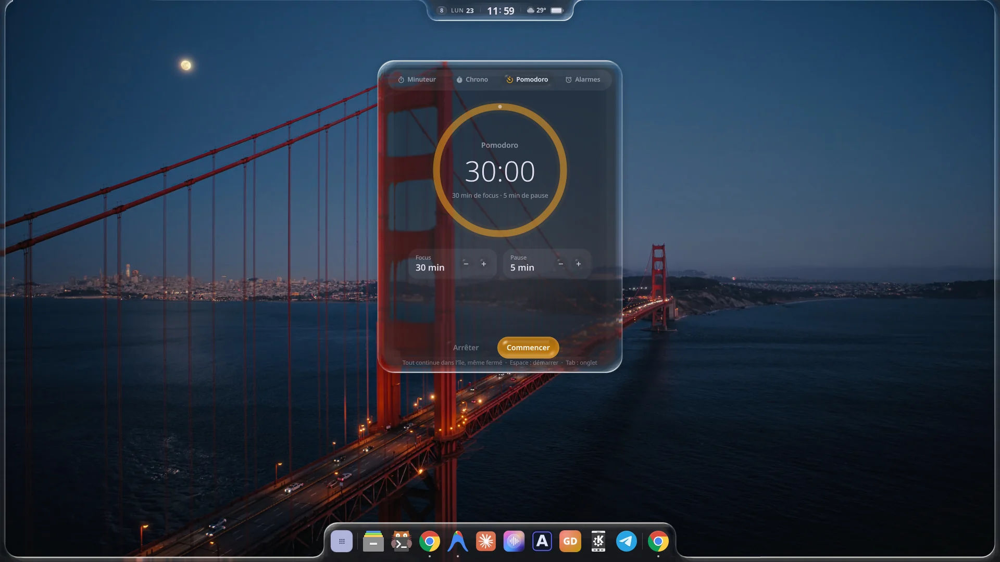
      <br /><sub><b>Optical Refraction Glass Drops</b> — Clock, Timer, Stopwatch &amp; Pomodoro morphing out of the Island with real-time edge refraction</sub>
    </td>
    <td width="50%">
      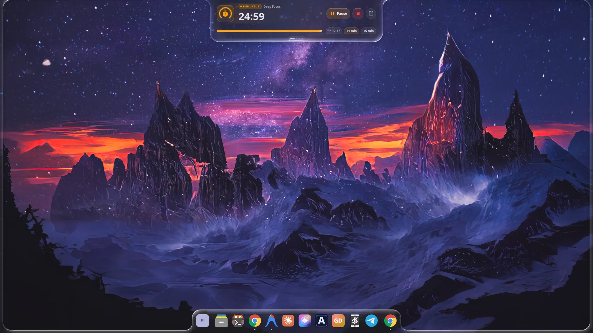
      <br /><sub><b>Dynamic Island · Active Focus Timer</b> — Live countdown progress, quick +1/+5 min actions, and seamless glass card transitions</sub>
    </td>
  </tr>
  <tr>
    <td width="50%">
      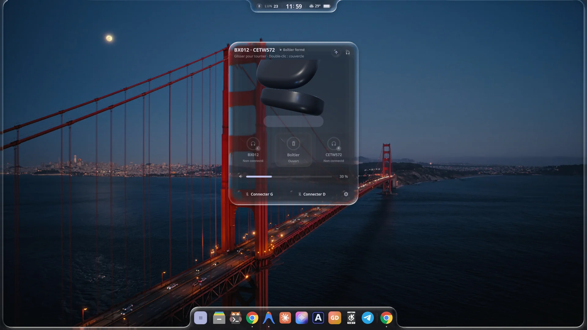
      <br /><sub><b>3D Interactive Earbuds HUD</b> — AirPods-style glass drop with real-time 3D case animation, L/R Bluetooth controls &amp; volume</sub>
    </td>
    <td width="50%">
      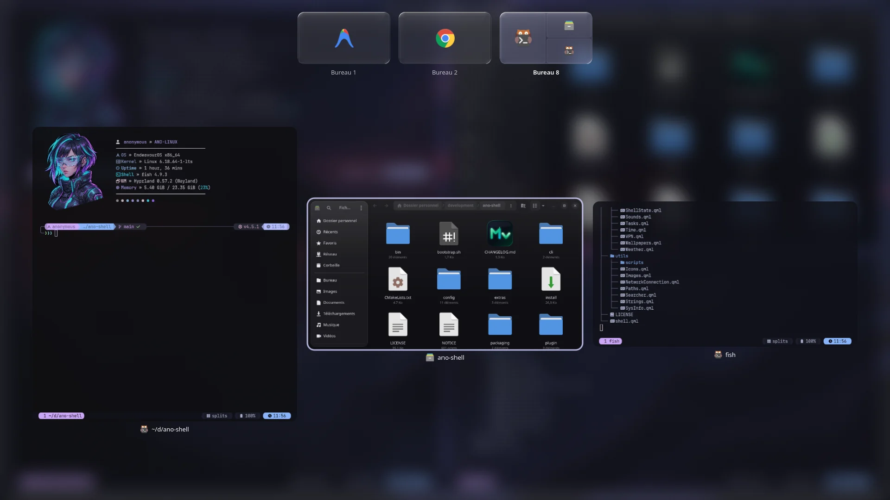
      <br /><sub><b>Mission Control</b> — Live window overview grid &amp; workspace thumbnails via <code>Super + Tab</code> or 3-finger swipe ↑</sub>
    </td>
  </tr>
  <tr>
    <td width="50%">
      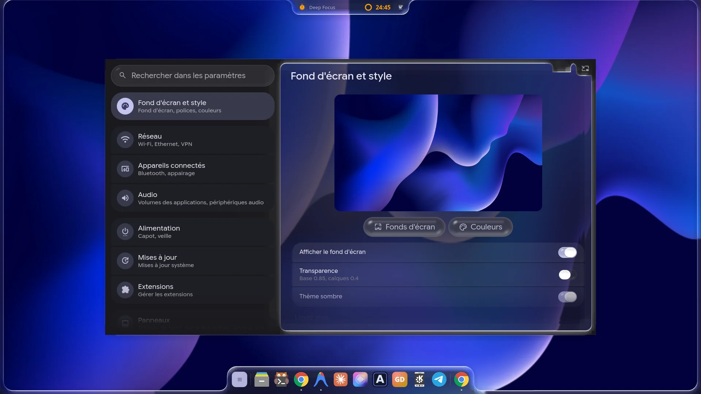
      <br /><sub><b>Live Settings &amp; Material You</b> — Instant wallpaper palettes, glass density, dark/light switch &amp; live performance profiles</sub>
    </td>
    <td width="50%">
      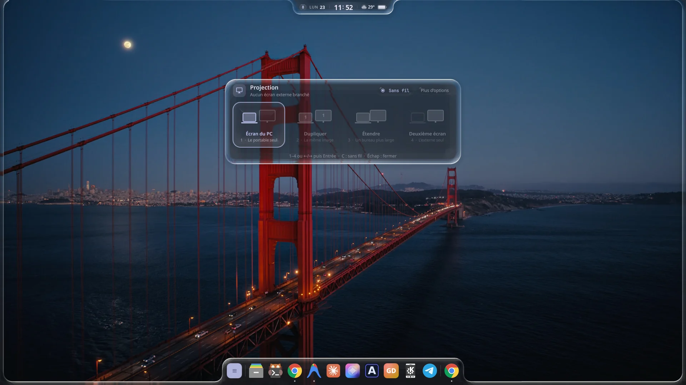
      <br /><sub><b>Display Projection &amp; Dock</b> — Instant single/mirror/extend/wireless display switcher (<code>Super + P</code>) &amp; macOS-style Dock</sub>
    </td>
  </tr>
  <tr>
    <td colspan="2" align="center">
      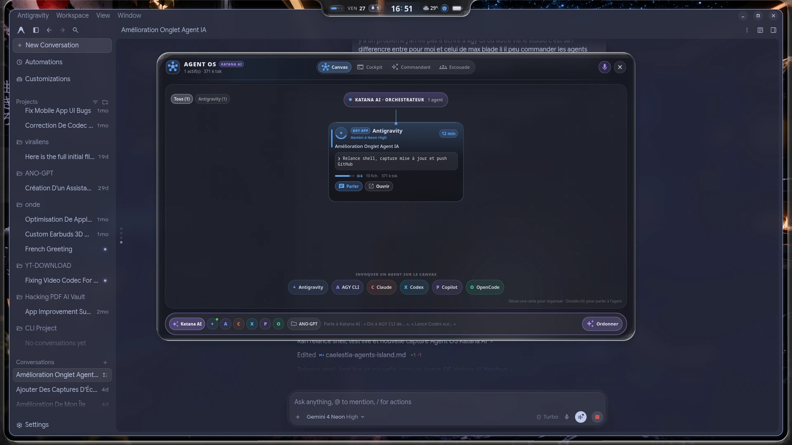
      <br /><sub><b>Agent OS · Katana-Style Multi-Agent Studio</b> — Spatial Liquid Glass canvas, live activity inspector &amp; parallel Squad dispatch for Antigravity, Claude Code, Codex, Copilot &amp; OpenCode (<code>Super + Shift + A</code>)</sub>
    </td>
  </tr>
</table>

---

## ⚡ Why Ano Shell?

- **100% Standalone & Native C++**: custom Qt6 C++ plugins (`AnoShell.*` + `AnoShell.Shapes`) with native PipeWire + `fftw3` audio spectrum and C++ `SystemWatch` (`/sys` telemetry without `fork/exec`). Zero `caelestia-shell`, `caelestia-cli`, `libcava`, `sndio`, or `aubio` dependencies.
- **Full Liquid Glass Ecosystem**: Dynamic Island iOS 27 (info, live performance/processes, media + synced lyrics, notifications, AI agents HUD, clock, transfers), Control Center, auto-hiding Dock, 14 refractive glass popups, Mission Control, Lock Screen, **SDDM Liquid Glass**, **Nautilus + Sushi** (GTK4/3 + File Chooser Portal), **Qt/KDE Darkly**, **Kitty** (pill tab bar + `Super + \`` dropdown), **Fastfetch**, **Fish + Starship** (`eza`, `zoxide`), and **`onde-cli`** terminal music player.
- **Smooth on 2-Core Laptops & Dedicated GPUs**: hardware-aware installer with **3 performance profiles** (`ultra` / `eco` / `auto`), fast GLSL shader (`liquidios-fast.frag`), event-driven window mask, lazy-loaded modal panels (`LazyPanel`), and on-demand daemons.
- **Bilingual EN / FR UI**: follows your system locale automatically and switches live in **Settings (`Super + I`) → Language & region**.

---

## 🎛️ Performance Profiles

Choose your profile interactively during `./install`, via CLI flags, or live in **Settings (`Super + I`) → Wallpaper & style**:

| Profile | Best for | Behavior |
| :--- | :--- | :--- |
| **`ultra`** | Dedicated GPU / Desktop / Gaming laptop | Full optical refraction shader (`liquidios.frag`), preloaded panels, maximum visual fidelity |
| **`eco`** *(Fluid)* | 2-core Intel laptops / iGPU / Battery life | Optimized shader (`liquidios-fast.frag`, ~2× fewer texture fetches, identical look), lazy-loaded panels (unloaded after 90 s idle), low CPU/RAM |
| **`auto`** | Hybrid laptops | Switches automatically between `ultra` on AC power and `eco` on battery |

```bash
./install --profile auto        # or ultra | eco
ano-shell glass --performance auto
```

---

## 🚀 Step-by-Step Beginner Guide (From a Fresh Arch Linux Install)

Never configured Hyprland before? Follow these **4 simple steps**:

### Step 1 — Install minimal Arch Linux (`archinstall`)
1. Boot the Arch Linux ISO and run `archinstall`.
2. Pick:
   - **Profile** → **`Minimal`** (or **`No desktop`**)
   - **Audio** → **`PipeWire`**
   - **Network configuration** → **`Use NetworkManager`**
   - **User account** → create a normal user with **`Superuser (sudo) = Yes`**
3. Finish installation and reboot without the USB stick.

### Step 2 — Log in at the black screen (TTY)
1. Type your username and password.
2. If on Wi-Fi, connect with `nmtui` (*Activate a connection* → pick your network → Quit). Ethernet works automatically.

### Step 3 — Run the 1-command automatic installer

```bash
curl -fsSL https://raw.githubusercontent.com/Abdoul273/ano-shell/main/bootstrap.sh | bash
```

*(Or build & install the Arch package locally via `cd packaging/aur && makepkg -si && ano-shell setup`.)*

> **Bilingual EN / FR:** the installer automatically detects your system locale and lets you choose **English** or **Français** (or pass `--lang en` / `--lang fr`). Switch anytime via `ano-shell lang en|fr|auto` or **Settings (`Super + I`) → Language & region**.

Enter your `sudo` password once and wait ~5–15 minutes while everything installs and builds automatically:
- **Full Wayland/Hyprland stack**: Hyprland, portals, PipeWire, Bluetooth, NetworkManager, Power Profiles, **SDDM Liquid Glass login screen** + macOS cursor.
- **Native Qt6 C++ plugins (`AnoShell.*` + `AnoShell.Shapes`)**: built automatically with native PipeWire + `fftw3` audio spectrum and C++ `SystemWatch`.
- **Full Liquid Glass theme everywhere**: Dynamic Island, Control Center, Dock, 14 glass popups, Mission Control, Lock Screen, **Nautilus + Sushi**, **Qt/KDE Darkly**, **Kitty**, **Fastfetch**, **Fish + Starship**, **Firefox**, and **`onde-cli`**.
- **Automatic hardware tuning**: detects your GPU, CPU cores and battery to recommend the optimal Liquid Glass profile.

### Step 4 — Reboot & Enjoy

```bash
sudo reboot
```

Press **`Super + H`** anytime on the desktop to open the interactive shortcuts search.

---

## 🔧 Install on an Existing Hyprland Setup

Non-destructive (creates a timestamped backup and adds 1 `source` line):

```fish
git clone https://github.com/Abdoul273/ano-shell.git
cd ano-shell
./install
# pick a performance profile directly:
./install --profile ultra          # ultra | eco | auto
# or migrate settings from Caelestia Liquid Glass:
./install --migrate-caelestia
```

Reversible anytime via `./uninstall`.

---

## ⌨️ Essential Shortcuts (Pre-configured)

Press **`Super + H`** anytime to search and trigger any shortcut.

| Shortcut | Action |
| :--- | :--- |
| **`Super + Space`** | Spotlight search (glass popup) |
| **`Super + A`** | Liquid Glass Control Center (or top-right hot corner) |
| **`Super + N`** | Notification Center inside the Island |
| **`Super + I`** | Settings (Liquid Glass, performance profiles, themes, EN/FR language) |
| **`Super + T`** / **`Super + Enter`** | Kitty Liquid Glass terminal |
| **`Super + \``** | Quake-style dropdown Kitty terminal |
| **`Super + E`** | Nautilus file manager (Liquid Glass + `Space` Quick Look) |
| **`Super + W`** | Web browser |
| **`Super + M`** | **`onde-cli`** terminal music player (word-synced lyrics in the Island) |
| **`Super + V`** / **`Super + .`** / **`Super + O`** | Clipboard / Emoji / Calculator glass popups |
| **`Super + P`** | Display projection (Single, Duplicate, Extend, Wireless) |
| **`Super + Shift + N`** / **`T`** | Quick Notes / Quick Tasks |
| **`Super + Shift + O`** / **`B`** / **`A`** | Clock (timer/pomodoro/alarms) / 3D Earbuds HUD / **Agent OS** multi-agent studio |
| **`Super + Shift + Space`** | Voice assistant (`ano-siri`, on-demand) |
| **`Super + Shift + D`** / **`W`** / **`Super + Alt + T`** | Dictation / Writing tools / Translate |
| **`Super + Tab`** (or 3-finger swipe ↑) | Mission Control |
| **`Print`** / **`Super + Print`** | Fullscreen / Region + Annotate screenshot |
| **`Super + L`** / **`Ctrl + Alt + Del`** | Lock screen / Session menu |
| **`Super + Q`** / **`Super + Shift + Q`** | Close window / Fully quit app |
| **`Super + Shift + R`** | Reload Hyprland + Ano Shell |

---

## 💻 CLI Overview (`ano-shell`)

| Command | Description |
| :--- | :--- |
| `ano-shell setup [--lang en\|fr]` | Deploy all user configs (Hyprland, Kitty, Fastfetch, Nautilus/GTK, Fish, Starship, SDDM) |
| `ano-shell lang [auto\|en\|fr]` | Show or switch interface & CLI language live |
| `ano-shell shell -d` / `-k` | Start or safely stop the shell (blocks kill while screen is locked) |
| `ano-shell wallpaper -f ` | Set wallpaper and generate Material You dynamic palette |
| `ano-shell scheme set -m dark\|light` | Switch theme or color mode |
| `ano-shell glass --auto` | Detect GPU/battery and apply the best Liquid Glass profile |
| `ano-shell glass --performance ultra\|eco\|auto` | Switch Liquid Glass shader & lazy-loading profile live |
| `ano-shell theme` | Regenerate GTK4/3 Liquid Glass, GTK3 portal, Qt/Darkly and Hyprland colors |
| `ano-shell screenshot` / `record` | Fullscreen/region screenshot and `gpu-screen-recorder` capture |
| `ano-shell doctor` | Check Quickshell Qt6 ABI alignment, plugin `ldd`, JSON configs and Hyprland |
| `ano-shell migrate` | Non-destructively copy settings from `~/.config/caelestia` |
| `onde-cli` | Launch interactive terminal music player synced with the Dynamic Island |

---

## 🤝 Contributing & Community

Bug reports, hardware/GPU feedback, new translations (i18n), and PRs are warmly welcomed!
- Read **[CONTRIBUTING.md](CONTRIBUTING.md)** to get started.
- Join **[GitHub Discussions](https://github.com/Abdoul273/ano-shell/discussions)** to share your setup or ask questions.

## 📄 License & Attribution

Licensed under **GPL-3.0**. Derived from [caelestia-dots/shell](https://github.com/caelestia-dots/shell) (GPL-3.0) and [m3shapes](https://github.com/soramanew/m3shapes) (Apache-2.0); see [NOTICE](NOTICE).
